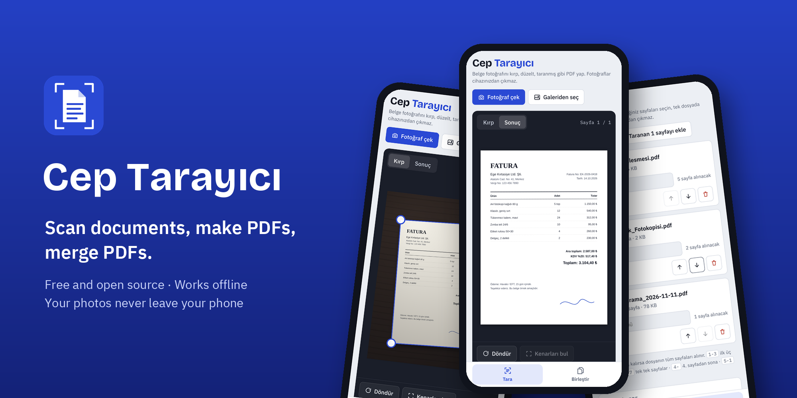
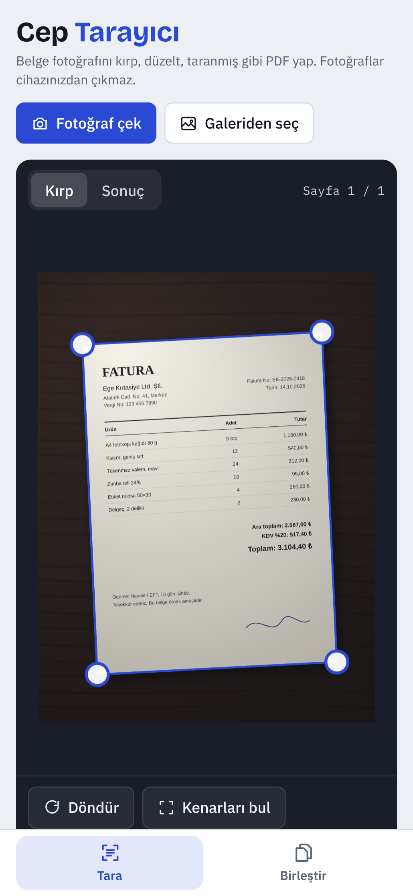
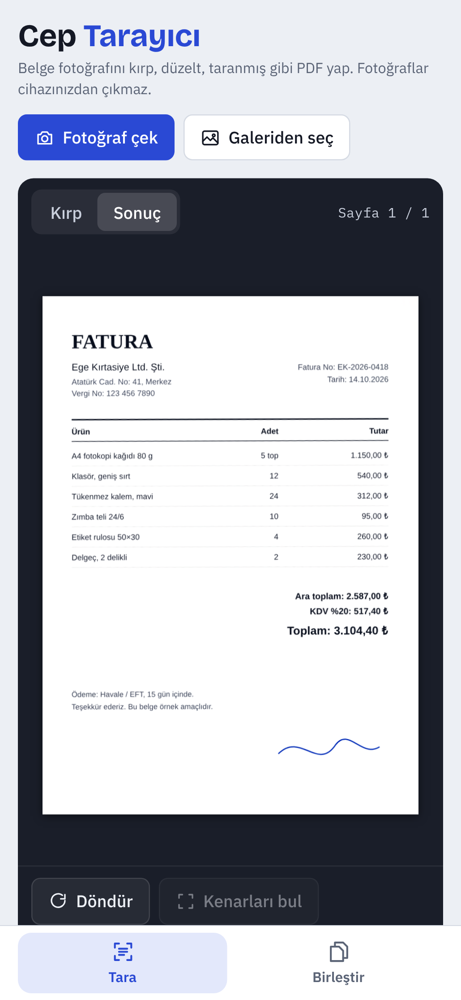
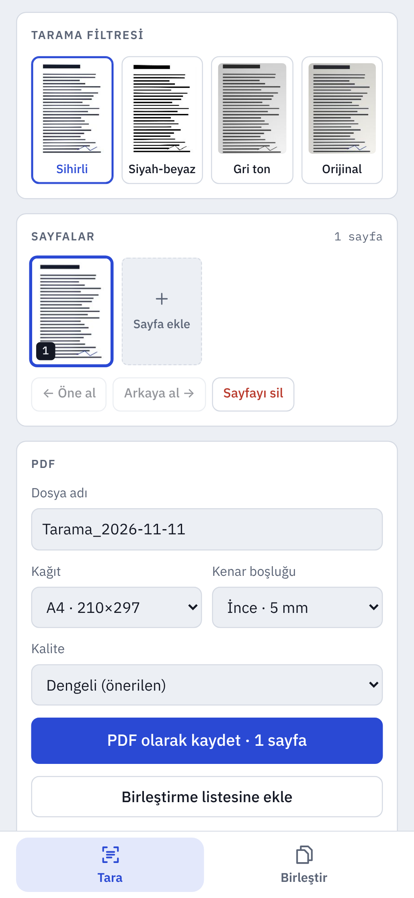
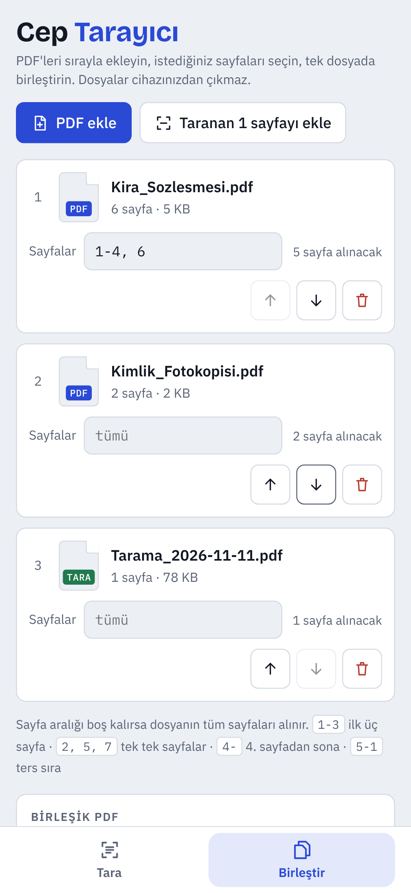
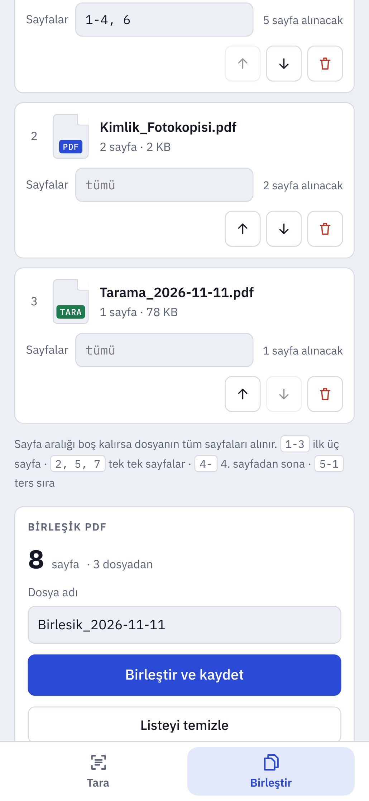
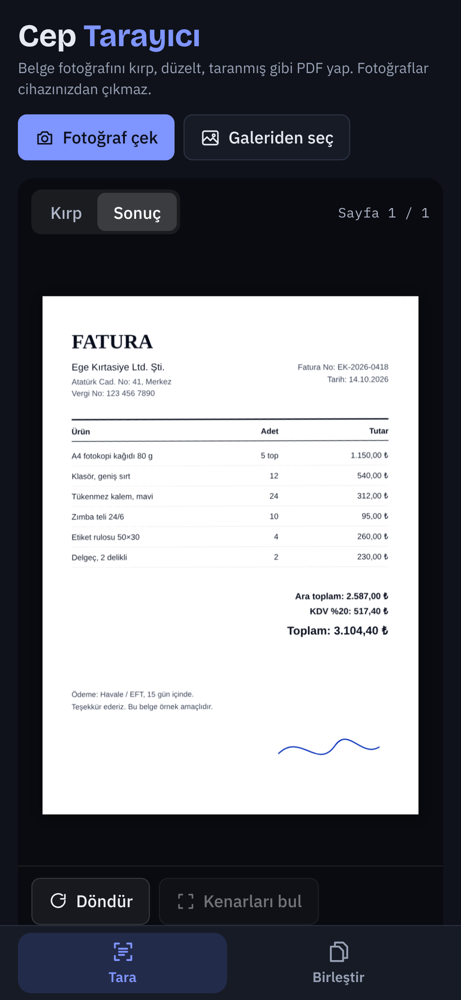
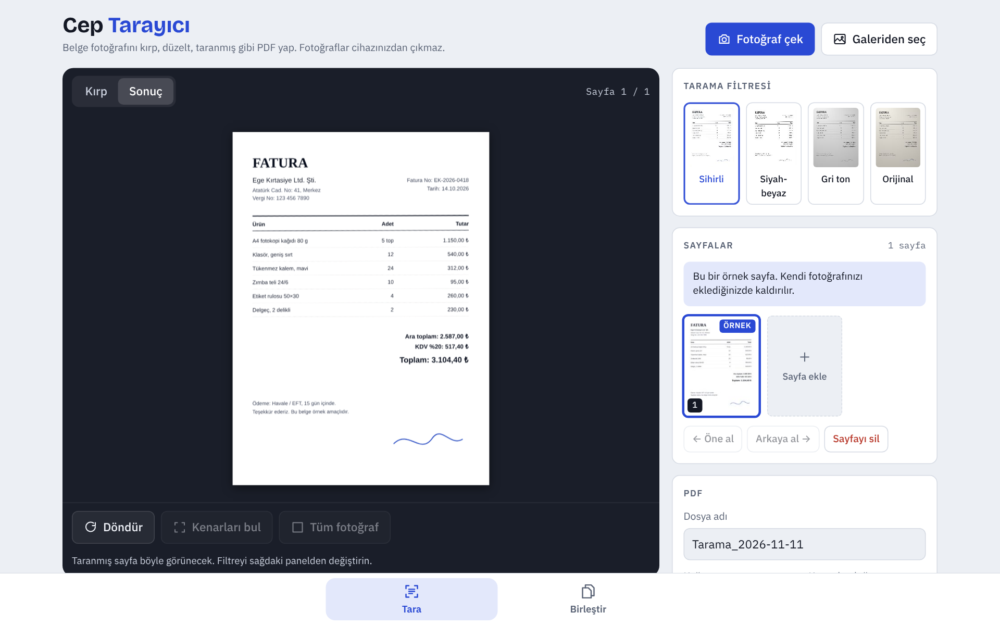

<p align="center">
  
</p>

<p align="center">
  <b>English</b> · <a href="README.tr.md">Türkçe</a>
</p>

<p align="center">
  
  
  
  
</p>

# Cep Tarayıcı

**Cep Tarayıcı** ("pocket scanner" in Turkish) turns photos of paper documents into clean, scanned-looking PDFs, and merges PDFs into one file. It is a free, open-source alternative to the few features most people actually use in paid scanner apps.

- **No account, no subscription, no ads.**
- **Nothing leaves your phone.** Photos and PDFs are processed on the device. The app makes no network requests.
- **Tiny.** The whole Android app is under 1 MB.

> The interface is in Turkish. An English UI is on the [ideas list](#ideas).

## Download

| | |
|---|---|
| **Android** | Download `CepTarayici-vX.Y.Z.apk` from the [latest release](../../releases/latest), open it on your phone and allow "install unknown apps" when asked. |
| **iPhone, desktop or any browser** | Open the web version at `https://USERNAME.github.io/cep-tarayici/`. On iPhone tap *Share → Add to Home Screen* to use it like an app; it works offline after the first visit. |

## Screenshots

| Crop | Scanned result | Filters and export |
|:---:|:---:|:---:|
|  |  |  |
| **Merge PDFs** | **Merge and save** | **Dark mode** |
|  |  |  |

<p align="center"></p>

## Features

### Scan
- Take a photo with the phone camera or pick several from the gallery.
- **Automatic edge detection** finds the paper in the photo.
- Drag the four corners to fine-tune; a **magnifier** shows what is under your finger.
- **Perspective correction** flattens a tilted shot into a straight page.
- Four filters: **Magic** (white paper, no shadows), **Black & white**, **Grayscale**, **Original**.
- Rotate, reorder and delete pages.
- Multi-page PDF in **A4**, **Letter** or the image's own size, with margins and three quality levels.

### Merge
- Add any number of PDFs and put them in order with the arrow buttons.
- Choose pages per file: `1-3` first three pages, `2, 5, 7` single pages, `4-` page 4 to the end, `5-1` reverse order. Leave it empty for all pages.
- **Add to merge list** sends the current scan straight into the merge list, so you can, for example, append a signed page to a contract.
- Broken and password-protected PDFs are flagged with the reason.
- Undo for removed files and a cleared list.

### Saving
- **Android:** PDFs are saved to *Downloads › Cep Tarayıcı*, then the share button opens the Android share sheet (WhatsApp, Drive, e-mail…).
- **Web:** on phones the share sheet opens; on desktop the PDF is downloaded.

## How it works

Everything runs in plain JavaScript inside one HTML file ([`web/index.html`](web/index.html)). The Android app is a thin native wrapper around that same file.

| Step | Technique |
|---|---|
| Edge detection | The photo is shrunk to 360 px, converted to grayscale and thresholded with **Otsu's method**. The largest bright connected region is taken as the paper; its corners are the pixels with the extreme values of *x + y* and *x − y*. |
| Perspective correction | A **homography** is solved from the four corners (8×8 linear system, Gaussian elimination) and every output pixel is sampled from the photo with **bilinear interpolation**. |
| Magic filter | The paper's background light is estimated by shrinking the page, applying a **max filter** to erase the text and blurring it. Dividing the page by this background removes shadows and uneven lighting, then a contrast curve whitens the paper. |
| Black & white | Same background normalisation, followed by a soft threshold so thin strokes survive. |
| PDF export | [jsPDF](https://github.com/parallax/jsPDF) places each page as a JPEG on an A4/Letter page. |
| Merging | [pdf-lib](https://github.com/Hopding/pdf-lib) copies the selected pages of each file into a new document without re-compressing them. |

The Android wrapper ([`android/src`](android/src/com/ceptarayici/app)) is about 400 lines of Java with no libraries:

- A `WebView` serves the files from the APK's assets at `https://appassets.androidplatform.net/`.
- **Camera** uses the system camera app (`ACTION_IMAGE_CAPTURE`) writing into the app's own `ContentProvider`, so the app needs **no camera permission**.
- PDFs are written to Downloads through `MediaStore`, and large files are streamed from JavaScript in chunks.
- The only permission is `INTERNET`, which Android's WebView needs to load the app's own pages. The app itself makes no network requests.

## Project structure

```
cep-tarayici/
├── web/                     # The app (also the web version)
│   ├── index.html           # UI, scanning, filters, PDF export, merging
│   ├── jspdf.umd.min.js     # PDF creation (MIT)
│   ├── pdf-lib.min.js       # PDF merging (MIT)
│   ├── fonts/, fonts.css    # Bundled fonts, no Google Fonts requests
│   ├── manifest.webmanifest # Installable web app
│   └── sw.js                # Offline cache for the web version
├── android/
│   ├── AndroidManifest.xml
│   ├── res/                 # Icons, themes (light and dark)
│   └── src/com/ceptarayici/app/
│       ├── MainActivity.java   # WebView, camera, file picker, saving, back button
│       └── FilesProvider.java  # Shares camera photos and PDFs with other apps
├── scripts/
│   ├── build-apk.sh         # Builds and signs the APK (no Gradle)
│   └── align.py             # 4-byte zip alignment
├── docs/screenshots/
└── .github/workflows/
    ├── android.yml          # Builds the APK; publishes a release for v* tags
    └── pages.yml            # Deploys web/ to GitHub Pages
```

## Building

### Web version
There is no build step. Serve the `web` folder with any static server:

```bash
cd web && python3 -m http.server 8000
# open http://localhost:8000
```

### Android APK
Requirements: Linux x64 (or WSL), Java 17+, Node.js with npm, Python 3, `zip`.

```bash
scripts/build-apk.sh
# → dist/CepTarayici.apk
```

The script downloads the Android build tools (aapt2, d8, apksigner, android.jar for API 34) from npm into `.tools/` the first time and checks their SHA-256. It does not need Android Studio, Gradle or the Android SDK. A full build takes about 10 seconds.

Without a key it signs with a throwaway test key. To sign with your own key:

```bash
KEYSTORE_FILE=~/keys/release.jks KEYSTORE_PASSWORD=... KEY_ALIAS=cep \
VERSION_NAME=1.3.0 VERSION_CODE=10300 scripts/build-apk.sh
```

> Keep your keystore safe and **never commit it**. Android only installs an update over an existing app when both are signed with the same key.

## Releases with GitHub Actions

Every push to `main` builds an APK; you can download it from the run's *Artifacts*.

To publish a release:

1. Add these under *Settings › Secrets and variables › Actions*:
   - `KEYSTORE_BASE64`: your keystore as base64 (`base64 -w0 release.jks`)
   - `KEYSTORE_PASSWORD`: the keystore and key password
   - `KEY_ALIAS`: the key alias (default `cep`)
2. Push a version tag:
   ```bash
   git tag v1.3.0 && git push origin v1.3.0
   ```
   The workflow builds `CepTarayici-v1.3.0.apk` with version code `10300` and attaches it to a new GitHub release.

### Web version on GitHub Pages
In *Settings › Pages* set **Source** to **GitHub Actions**. Every change in `web/` is then deployed to `https://USERNAME.github.io/cep-tarayici/`.

## Ideas

- English interface (and other languages)
- Text recognition (OCR) to make scanned PDFs searchable
- Opening PDFs shared from other apps straight into the merge list
- Splitting a PDF and extracting pages
- Signature stamp

Issues and pull requests are welcome.

## License

[MIT](LICENSE). Bundled and build-time third-party software is listed in [THIRD_PARTY_NOTICES.md](THIRD_PARTY_NOTICES.md).

Developed with the help of [Claude](https://claude.ai).
