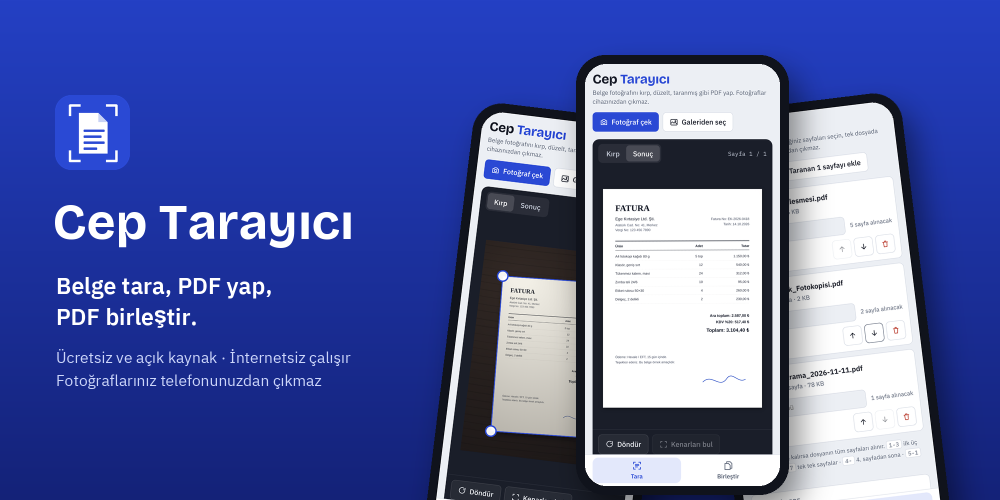
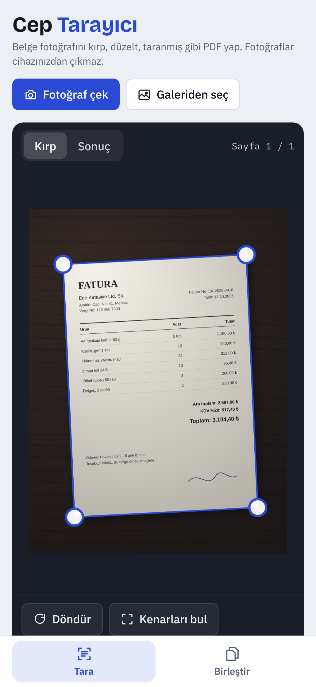
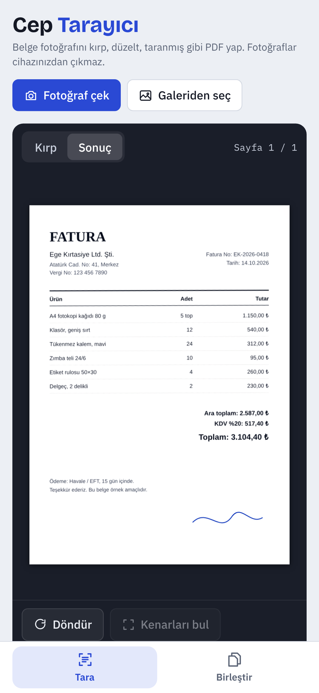
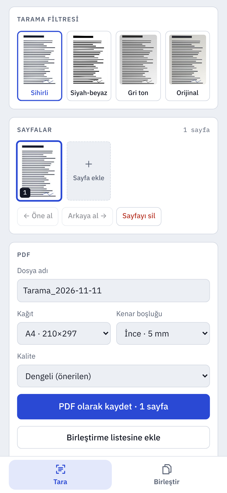
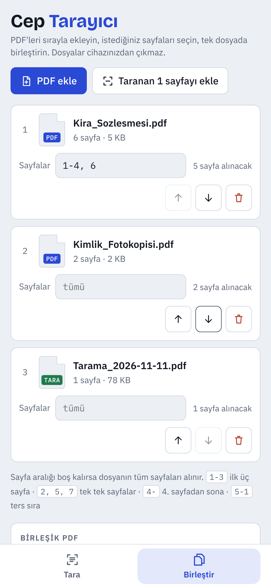
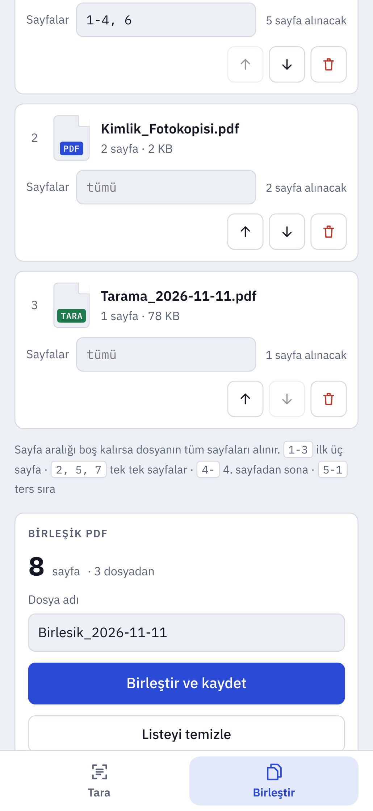
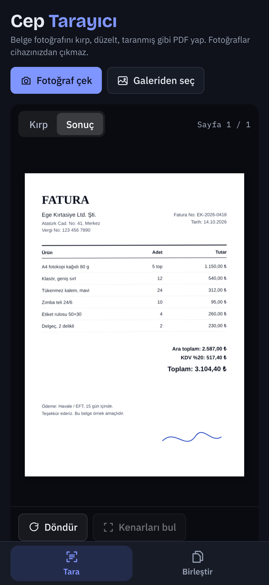
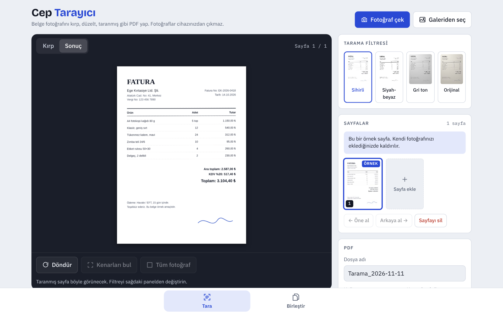

<p align="center">
  
</p>

<p align="center">
  <a href="README.md">English</a> · <b>Türkçe</b>
</p>

<p align="center">
  
  
  
  
</p>

# Cep Tarayıcı

**Cep Tarayıcı**, kağıt belgelerin fotoğraflarını taranmış gibi görünen temiz PDF'lere çevirir ve PDF dosyalarını tek dosyada birleştirir. Ücretli tarayıcı uygulamalarında çoğu kişinin gerçekten kullandığı birkaç özelliğin ücretsiz ve açık kaynak karşılığıdır.

- **Hesap, abonelik ve reklam yok.**
- **Hiçbir şey telefonunuzdan çıkmaz.** Fotoğraflar ve PDF'ler cihazda işlenir. Uygulama internete hiçbir istek göndermez.
- **Küçük.** Android uygulamasının tamamı 1 MB'tan küçük.

## İndir

| | |
|---|---|
| **Android** | [Son sürüm](../../releases/latest) sayfasından `CepTarayici-vX.Y.Z.apk` dosyasını indirin, telefonda açın ve sorulduğunda "bilinmeyen uygulamaları yükleme" iznini verin. |
| **iPhone, bilgisayar veya herhangi bir tarayıcı** | Web sürümünü `https://USERNAME.github.io/cep-tarayici/` adresinden açın. iPhone'da *Paylaş → Ana Ekrana Ekle* ile uygulama gibi kullanabilirsiniz; ilk açılıştan sonra internetsiz de çalışır. |

## Ekran görüntüleri

| Kırpma | Taranmış sonuç | Filtreler ve kaydetme |
|:---:|:---:|:---:|
|  |  |  |
| **PDF birleştirme** | **Birleştir ve kaydet** | **Karanlık tema** |
|  |  |  |

<p align="center"></p>

## Özellikler

### Tarama
- Telefon kamerasıyla fotoğraf çekin ya da galeriden birden çok fotoğraf seçin.
- **Otomatik kenar bulma**, fotoğraftaki kağıdı kendisi bulur.
- Dört köşeyi sürükleyerek ince ayar yapın; **büyüteç** parmağınızın altındaki noktayı gösterir.
- **Perspektif düzeltme**, eğik çekilmiş fotoğrafı düz bir sayfaya çevirir.
- Dört filtre: **Sihirli** (beyaz kağıt, gölgesiz), **Siyah-beyaz**, **Gri ton**, **Orijinal**.
- Sayfaları döndürme, sıralama ve silme.
- **A4**, **Letter** veya görüntü boyutunda, kenar boşluklu ve üç kalite seçenekli çok sayfalı PDF.

### Birleştirme
- İstediğiniz kadar PDF ekleyin, ok düğmeleriyle sıralayın.
- Her dosyadan hangi sayfaların alınacağını seçin: `1-3` ilk üç sayfa, `2, 5, 7` tek tek sayfalar, `4-` 4. sayfadan sona, `5-1` ters sıra. Boş bırakırsanız tüm sayfalar alınır.
- **Birleştirme listesine ekle** düğmesi o an taradığınız belgeyi doğrudan listeye gönderir. Örneğin bir sözleşmenin sonuna imzalı sayfayı ekleyebilirsiniz.
- Bozuk veya parola korumalı PDF'ler nedeniyle birlikte işaretlenir.
- Listeden çıkarılan dosyalar ve temizlenen liste geri alınabilir.

### Kaydetme
- **Android:** PDF'ler *İndirilenler › Cep Tarayıcı* klasörüne kaydedilir; Paylaş düğmesi Android paylaşım menüsünü açar (WhatsApp, Drive, e-posta…).
- **Web:** telefonda paylaşım menüsü açılır, bilgisayarda PDF indirilir.

## Nasıl çalışır

Her şey tek bir HTML dosyasının ([`web/index.html`](web/index.html)) içinde, düz JavaScript ile çalışır. Android uygulaması aynı dosyayı saran ince bir yerel kabuktur.

| Adım | Yöntem |
|---|---|
| Kenar bulma | Fotoğraf 360 piksele küçültülür, gri tona çevrilir ve **Otsu yöntemiyle** eşiklenir. En büyük açık renkli bölge kağıt kabul edilir; köşeleri *x + y* ve *x − y* değerleri en uçta olan piksellerdir. |
| Perspektif düzeltme | Dört köşeden bir **homografi** çözülür (8×8 doğrusal sistem, Gauss eliminasyonu) ve çıktıdaki her piksel fotoğraftan **bilineer enterpolasyonla** örneklenir. |
| Sihirli filtre | Kağıdın arka plan ışığı tahmin edilir: sayfa küçültülür, yazıyı silmek için **maksimum filtresi** uygulanır ve bulanıklaştırılır. Sayfa bu arka plana bölününce gölgeler ve dengesiz ışık kaybolur; ardından bir kontrast eğrisi kağıdı beyazlatır. |
| Siyah-beyaz | Aynı arka plan düzeltmesi, ardından ince çizgileri koruyan yumuşak bir eşik. |
| PDF oluşturma | [jsPDF](https://github.com/parallax/jsPDF) her sayfayı JPEG olarak A4/Letter sayfaya yerleştirir. |
| Birleştirme | [pdf-lib](https://github.com/Hopding/pdf-lib) seçilen sayfaları yeniden sıkıştırmadan yeni bir belgeye kopyalar. |

Android kabuğu ([`android/src`](android/src/com/ceptarayici/app)) hiçbir kütüphane kullanmayan yaklaşık 400 satır Java'dır:

- Bir `WebView`, APK'nın içindeki dosyaları `https://appassets.androidplatform.net/` adresinden sunar.
- **Kamera** için telefonun kendi kamera uygulaması (`ACTION_IMAGE_CAPTURE`) kullanılır ve fotoğraf uygulamanın kendi `ContentProvider`'ına yazılır. Bu yüzden uygulama **kamera izni istemez**.
- PDF'ler `MediaStore` üzerinden İndirilenler'e yazılır; büyük dosyalar JavaScript'ten parça parça aktarılır.
- Tek izin `INTERNET`'tir; Android'in WebView bileşeni uygulamanın kendi sayfalarını yüklemek için bunu ister. Uygulamanın kendisi internete hiçbir istek göndermez.

## Proje yapısı

```
cep-tarayici/
├── web/                     # Uygulamanın kendisi (aynı zamanda web sürümü)
│   ├── index.html           # Arayüz, tarama, filtreler, PDF oluşturma, birleştirme
│   ├── jspdf.umd.min.js     # PDF oluşturma (MIT)
│   ├── pdf-lib.min.js       # PDF birleştirme (MIT)
│   ├── fonts/, fonts.css    # Gömülü yazı tipleri, Google Fonts isteği yok
│   ├── manifest.webmanifest # Ana ekrana eklenebilir web uygulaması
│   └── sw.js                # Web sürümü için çevrimdışı önbellek
├── android/
│   ├── AndroidManifest.xml
│   ├── res/                 # Simgeler, açık ve karanlık tema
│   └── src/com/ceptarayici/app/
│       ├── MainActivity.java   # WebView, kamera, dosya seçici, kaydetme, geri tuşu
│       └── FilesProvider.java  # Kamera fotoğraflarını ve PDF'leri diğer uygulamalarla paylaşır
├── scripts/
│   ├── build-apk.sh         # APK'yı derler ve imzalar (Gradle gerekmez)
│   └── align.py             # Zip içeriğini 4 bayta hizalar
├── docs/screenshots/
└── .github/workflows/
    ├── android.yml          # APK'yı derler; v* etiketlerinde sürüm yayınlar
    └── pages.yml            # web/ klasörünü GitHub Pages'e yükler
```

## Derleme

### Web sürümü
Derleme adımı yoktur. `web` klasörünü herhangi bir sunucuyla açın:

```bash
cd web && python3 -m http.server 8000
# http://localhost:8000 adresini açın
```

### Android APK
Gerekenler: Linux x64 (veya WSL), Java 17+, Node.js ve npm, Python 3, `zip`.

```bash
scripts/build-apk.sh
# → dist/CepTarayici.apk
```

Betik ilk çalıştığında Android derleme araçlarını (aapt2, d8, apksigner, API 34 için android.jar) npm'den `.tools/` klasörüne indirir ve SHA-256 özetlerini doğrular. Android Studio, Gradle veya Android SDK gerekmez. Derleme yaklaşık 10 saniye sürer.

Anahtar verilmezse APK geçici bir test anahtarıyla imzalanır. Kendi anahtarınızla imzalamak için:

```bash
KEYSTORE_FILE=~/anahtarlar/release.jks KEYSTORE_PASSWORD=... KEY_ALIAS=cep \
VERSION_NAME=1.3.0 VERSION_CODE=10300 scripts/build-apk.sh
```

> Anahtar dosyanızı güvenli bir yerde saklayın ve **asla depoya eklemeyin**. Android, bir güncellemeyi ancak mevcut uygulamayla aynı anahtarla imzalanmışsa üzerine kurar.

## GitHub Actions ile sürüm yayınlama

`main` dalına yapılan her gönderimde APK derlenir; çalışmanın *Artifacts* bölümünden indirebilirsiniz.

Sürüm yayınlamak için:

1. *Settings › Secrets and variables › Actions* altına şunları ekleyin:
   - `KEYSTORE_BASE64`: anahtar dosyanızın base64 hali (`base64 -w0 release.jks`)
   - `KEYSTORE_PASSWORD`: anahtar deposu ve anahtar parolası
   - `KEY_ALIAS`: anahtar adı (varsayılan `cep`)
2. Bir sürüm etiketi gönderin:
   ```bash
   git tag v1.3.0 && git push origin v1.3.0
   ```
   İş akışı `10300` sürüm koduyla `CepTarayici-v1.3.0.apk` dosyasını derler ve yeni bir GitHub sürümüne ekler.

### Web sürümünü GitHub Pages'te yayınlama
*Settings › Pages* bölümünde **Source** olarak **GitHub Actions** seçin. Bundan sonra `web/` içindeki her değişiklik `https://USERNAME.github.io/cep-tarayici/` adresine yüklenir.

## Fikirler

- İngilizce arayüz (ve diğer diller)
- Taranan PDF'lerde arama yapılabilmesi için metin tanıma (OCR)
- Diğer uygulamalardan paylaşılan PDF'leri doğrudan birleştirme listesine açma
- PDF bölme ve sayfa ayıklama
- İmza ekleme

Hata bildirimleri ve katkılar memnuniyetle karşılanır.

## Lisans

[MIT](LICENSE). Birlikte gelen ve derleme sırasında indirilen üçüncü taraf yazılımlar [THIRD_PARTY_NOTICES.md](THIRD_PARTY_NOTICES.md) dosyasında listelenmiştir.

[Claude](https://claude.ai) yardımıyla geliştirildi.
